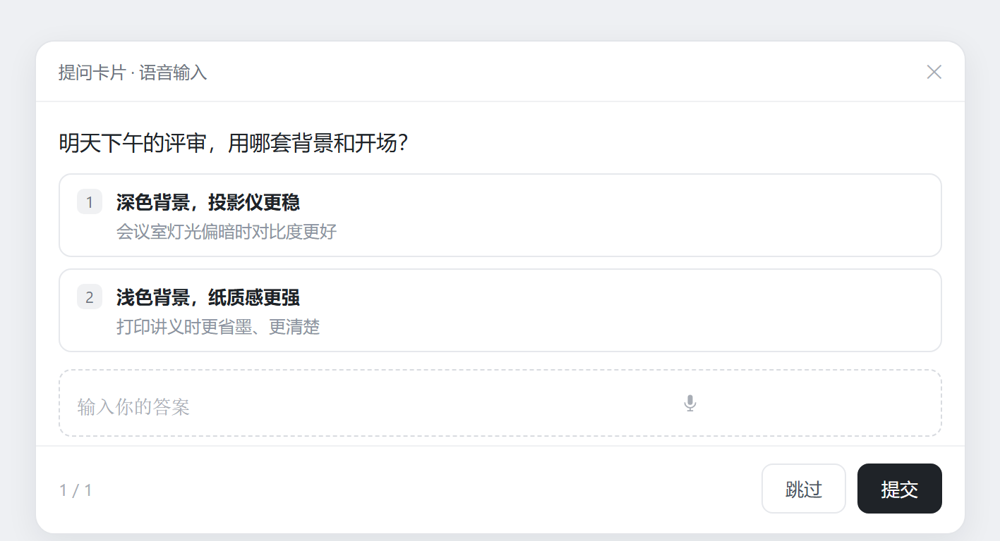
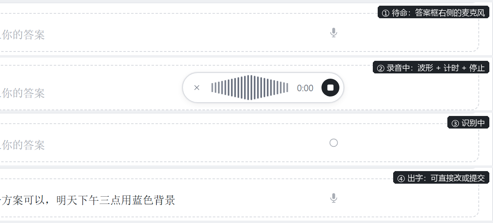
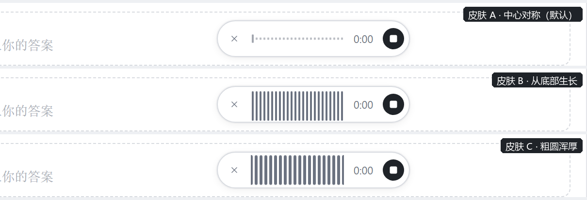

# dsh-question-voice

Voice input for the **answer card** in the DeepSeekRuntime (DSH) Web GUI. When `ask_user_question` opens a card, a small mic appears on the right of the free-text answer field: click to record, click the stop button to transcribe, and the recognised text is inserted into that same field — still editable, still submitted by you.

The built-in dictation in DSH only covers the chat composer. This plugin brings the same microphone to the question card, without touching either the chat composer or any official package.

## What it looks like



That is the full card. The plugin only adds a mic to the free-text answer row — the options, the page counter, skip/submit and the close button stay exactly as they are.



- A mic icon sits to the right of the answer field. The textarea is never replaced or hidden: voice and typing coexist.
- While recording, a compact bar expands in place: `×` cancel, a live waveform, a timer, and a stop button. Transcription starts only after you stop — the same rhythm as the official mic.
- The recognised text is inserted at the end of the field, separated from existing text by a space, with the caret left at the end.

## How it works

- **No official package is modified.** The question card (`@deepseek-ai/dsh-client-ui-user-questions`) exposes no overlay slot, so the client half watches the card DOM with a `MutationObserver` and attaches the button next to the free-text `textarea`.
- **It reuses the speech service already running in your profile** — `ctx.remote.speech` (`catalog / prepare / transcribe`), provided by `@deepseek-ai/dsh-experimental-voice-input-bundle`.
- **It mounts its own remote descriptor.** That namespace is not part of the static `dsh-api-remotes` composition; the official voice-input client mounts it at startup with `ctx.remote.$mount()`. A third-party plugin cannot see it, so this plugin mounts a minimal contribution declaring only `speech/transcribe` (strict parameter codec, `cancellation:{parameter:'signal'}`). Mounting is idempotent.
- **Audio never leaves the machine**: `getUserMedia` → `MediaRecorder` → `decodeAudioData` → resample to 16 kHz mono via `OfflineAudioContext` → WAV with a hand-written 44-byte header → base64 → the local speech service.
- **The write-back uses React's own path**: the native value setter on the textarea prototype plus a bubbling `input` event, so the card's `onChange` stores it in the draft and submits it with the answer.
- **No build step**: `lib/client.js` is a hand-written `window.__ModuleLoader__.load({ id, factory })` bundle requiring only `react` and `react-dom/client`.

## Install

Prerequisite: `@deepseek-ai/dsh-experimental-voice-input-bundle` is enabled in your profile (if the chat composer has a mic, it is).

One line (recommended):

```bash
dsh plugin add github:Jd44chs/dsh-question-voice#v0.1.0 --profile desktop
```

Then refresh the Web GUI (Ctrl+R). The host half is an empty stub, but the bundle entry is still mounted at process start — if the mic does not show up after a refresh, restart DSH once.

<details>
<summary>Manual install (if you prefer not to use <code>dsh plugin add</code>)</summary>

1. Put this repository anywhere, then add it to your profile's `package.json`:

```json
"dependencies": {
  "dsh-question-voice": "link:/absolute/path/to/dsh-question-voice"
}
```

2. Add the entry to the profile's `cordis.patch.yml`:

```yaml
- insert:
    - id: dsh-question-voice
      name: 'dsh-question-voice'
```

3. Make sure `node_modules/dsh-question-voice` links to the plugin directory, then refresh the Web GUI (Ctrl+R); restart DSH if the button does not appear.

</details>

On Windows, edit `cordis.patch.yml` byte-exactly (Python is safest). PowerShell's `Set-Content -Encoding UTF8` writes a BOM, converts LF to CRLF and mangles non-ASCII comments, which breaks the YAML.

## Behaviour

| Action | Result |
| --- | --- |
| Click the mic | Requests the microphone, starts recording, expands the recording bar |
| Click the stop button | Stops, encodes a 16 kHz mono WAV, transcribes locally, inserts the text |
| Click `×` / press Esc / hide the window | Cancels the recording, nothing is inserted |
| 120 seconds | Stops and transcribes automatically |

Errors (microphone denied, nothing recognised, recording too long, speech service missing) show as a small dot on the button with the reason in its tooltip; no dialogs, no interruption while typing.

## Waveform skins

Three looks for the bars in the recording bar; A is the default (each row below is the real recording bar rendered by this plugin):



| Skin | Look |
| --- | --- |
| `A` centre mirror | Tall in the middle, short at the edges — a breathing sound-wave shape (default) |
| `B` bottom growth | Every bar grows from the bottom; the most direct and the widest swing |
| `C` chunky | Wider, rounder bars; softer and calmer |

Switch with one line in the browser console, then refresh:

```js
localStorage.setItem('dqv:skin', 'B')   // A / B / C
```

## Limits

- Requires `@deepseek-ai/dsh-experimental-voice-input-bundle` to be enabled in the profile.
- The card's CSS module class names carry a build hash (`wnLwla` today); a DSH upgrade that changes the hash needs the selectors in `src/client/ui.js` updated.
- Only the free-text answer field gets a mic; choice buttons do not.
- The transcription language follows the profile's speech settings.

## Development

```
lib/client.js      client half (hand-written ModuleLoader bundle, no build)
lib/index.js       empty host half, only to satisfy the dsh.client declaration
src/client/ui.js   same source as lib/client.js — edit this, then copy over
cordis.patch.yml   the bundle's insert entry
```

`BUILD_TAG` in `lib/client.js` changes with each version and prints `[dqv] build <tag>` on page load, so you can tell which build a page is running. For debugging, inspect `window.__dqv` (last 60 events) or `localStorage['dqv:log']` (last 120, timestamped).

## License

MIT
