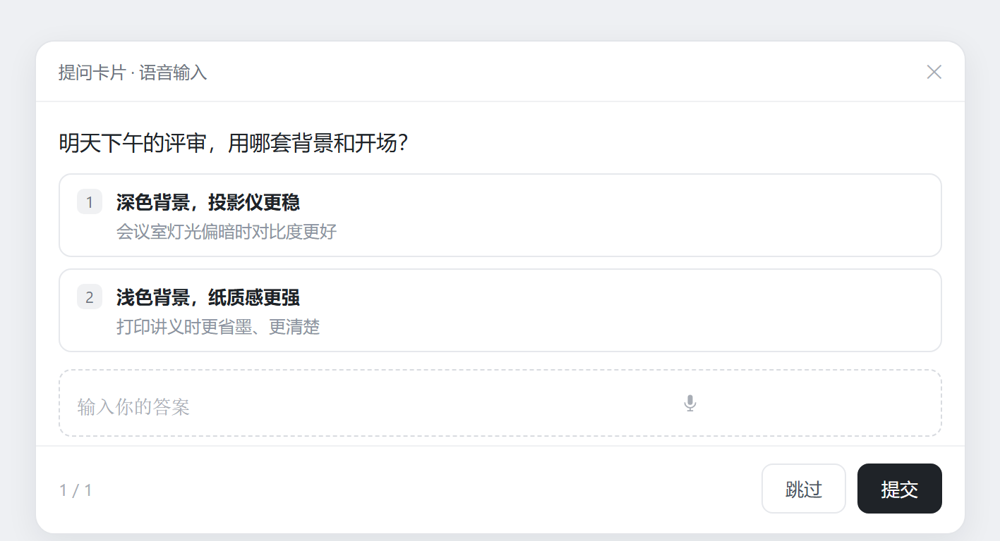
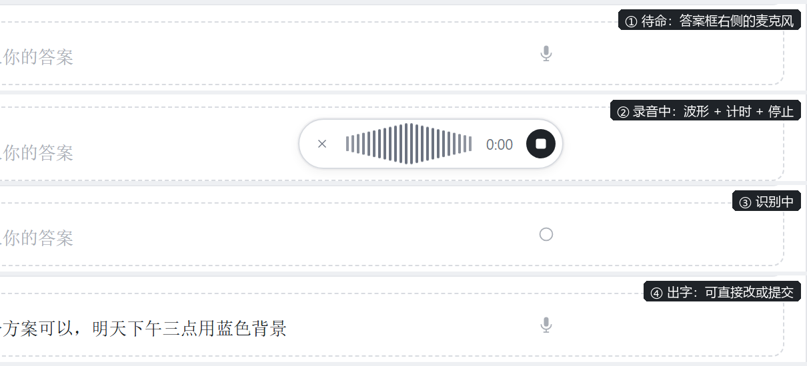
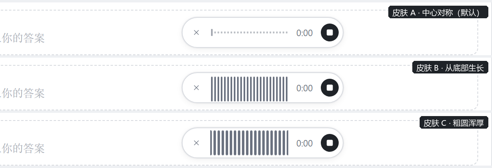

# dsh-question-voice

给 DeepSeekRuntime（DSH）Web GUI 的**提问卡片**加语音输入：`ask_user_question` 弹出的卡片里，「自定义答案」输入框右侧多一个麦克风按钮——点一下开始录音，再点一下停止，本地语音识别（SenseVoice）把话变成文字直接落进这个输入框，你可以继续改、然后回车提交。

> Voice input for the answer card that `ask_user_question` renders in the DSH Web GUI. Click the mic beside the free-text field, speak, click again to stop: the recording is transcribed by the speech service already running in your profile and the text lands in that field, still editable, still submittable by hand.

**为什么需要它**：DSH 自带语音输入只覆盖聊天输入框；一旦弹出提问卡片，要打字回答。这个插件把那同一个麦克风“平移”到卡片里，并且**不影响**聊天框原有的麦克风。

## 效果



整张卡片长这样——插件只往「自定义答案」那一行加了一个麦克风，选项、翻页、跳过/提交、右上角关闭都保持原样。



- 输入框右侧一个麦克风图标，不挤占、不替换原本的输入框：语音和手动打字并存。
- 录音时原地展开一条录音条：`×` 取消 · 实时波形 · 计时 · 停止钮。点停止才识别，和官方聊天框麦克风一样的节奏。
- 识别结果以插入方式写进输入框，跟已有文字自动用空格分隔，光标停在末尾，可继续手改或回车提交。
- 三款波形皮肤可切换（见下文「波形皮肤」）。

## 它怎么工作

- **不改官方包**。提问卡片（`@deepseek-ai/dsh-client-ui-user-questions`）没有可叠加的 slot 座位，所以客户端半边用 `MutationObserver` 盯住卡片 DOM，给自定义答案行的 `textarea` 旁挂按钮。卡片本身、官方任何文件都不动。
- **复用已经在跑的识别服务**。转写走 `ctx.remote.speech`（`speechController` 的 `catalog / prepare / transcribe`），由 profile 里已启用的官方实验 bundle `@deepseek-ai/dsh-experimental-voice-input-bundle` 提供。
- **自己挂载 remote 描述**。`speech` 这个 Remote namespace 并不在 `dsh-api-remotes` 的静态组合里，它由官方 voice-input 客户端在启动时 `ctx.remote.$mount()` 动态挂上去。第三方插件拿不到，所以本插件在 `apply()` 里自己 `$mount` 一份只含 `speech/transcribe` 的 contribution（参数 codec 必须 `mode:'strict'`，带 `cancellation:{parameter:'signal'}`），挂载幂等：已存在就直接用，重复挂载的错误串被当成“已就绪”。
- **录音与编码全在本地**：`getUserMedia` → `MediaRecorder` → `decodeAudioData` → `OfflineAudioContext` 重采样到 16 kHz 单声道 → 手写 44 字节头的 WAV → base64。音频只发给 profile 内那个本地识别服务。
- **写回走 React 自己的路径**：原生 `HTMLTextAreaElement.value` setter + 冒泡 `input` 事件，卡片 `onChange` 收到后进草稿 store，提交时随答案回传。
- **无构建步骤**：`lib/client.js` 是手写的 `window.__ModuleLoader__.load({ id, factory })` 形态，只 `require('react')` / `require('react-dom/client')`；`src/client/ui.js` 是同一份源码，改完手工复制。

## 安装

前提：profile 里已启用 `@deepseek-ai/dsh-experimental-voice-input-bundle`（DSH 桌面端插件管理器里能看到、且聊天输入框有麦克风就说明已在跑）。

一行装（推荐）：

```bash
dsh plugin add github:Jd44chs/dsh-question-voice#v0.1.0 --profile desktop
```

装完刷新 Web GUI（Ctrl+R）。**宿主半边是空的，但 bundle 条目仍需要 DSH 进程重启才会挂上**——如果刷完页面看不到按钮，重启一次 DSH 即可。

<details>
<summary>手动安装（不想用 <code>dsh plugin add</code> 时）</summary>

1. 把本仓库放进任意目录，然后在 profile 的 `package.json` 里加依赖（`link:` 指向本地目录，或用 `file:`）：

```json
"dependencies": {
  "dsh-question-voice": "link:E:/path/to/dsh-question-voice"
}
```

2. 在 profile 的 `cordis.patch.yml` 里加条目：

```yaml
- insert:
    - id: dsh-question-voice
      name: 'dsh-question-voice'
```

3. 在 profile 目录建好 `node_modules/dsh-question-voice` 链接（`mklink /J`，或直接 `npm install`）。
4. 刷新 Web GUI（Ctrl+R），看不到按钮就重启 DSH。

</details>

> Windows 上改 `cordis.patch.yml` 建议用 Python 字节级读写：PowerShell 的 `Set-Content -Encoding UTF8` 会写 BOM、把 LF 变 CRLF，中文注释会乱码，YAML 直接坏掉。

## 交互约定

| 操作 | 行为 |
| --- | --- |
| 点麦克风 | 请求麦克风 → 开始录音，原地展开录音条（波形 + 计时） |
| 再点停止钮 | 停止录音 → 16k 单声道 WAV → 本地转写 → 写入输入框 |
| 点 × | 取消本次录音，不写入 |
| 按 Esc | 取消本次录音 |
| 切走页面 / 窗口隐藏 | 取消本次录音 |
| 录满 120 秒 | 自动停止并转写 |

出错（麦克风被拒、没听清、录音过长、识别服务不在）时按钮右上角出现一个小红点，鼠标悬停看原因；不会弹窗、不打断你打字。

## 波形皮肤

录制条里那排跳动的柱子有三款观感，默认 A（下面是三款各自的录音条实拍）：



| 皮肤 | 观感 |
| --- | --- |
| `A` 中心镜像 | 两端矮、中间高的声纹形状，像在呼吸（默认） |
| `B` 底部生长 | 每根柱子从底部往上长，跳动最直接、幅度最大 |
| `C` 粗圆浑厚 | 柱子更宽、圆角更圆，柔和安静 |

切换（刷新后用浏览器控制台执行一次，再刷新）：

```js
localStorage.setItem('dqv:skin', 'B')   // A / B / C
```

## 已知边界

- 依赖 `@deepseek-ai/dsh-experimental-voice-input-bundle` 在 profile 中启用；那个 bundle 关掉，本插件的按钮只会报「找不到识别服务」。
- 卡片 DOM 类名带打包产物的哈希前缀（当前是 `wnLwla`），DSH 升级若改变哈希，需要同步改 `src/client/ui.js` 里的选择器。
- 只对「自定义答案」的文本输入框生效；选项按钮不做语音。
- 识别语言跟随 profile 里语音服务的设置（默认自动）。

## 开发

```
lib/client.js      ← 浏览器半边（手写 ModuleLoader 包，无构建）
lib/index.js       ← 宿主半边空实现（仅满足 dsh.client 声明）
src/client/ui.js   ← 与 lib/client.js 同内容，开发时改这份再复制
cordis.patch.yml   ← bundle 的插入条目
```

`lib/client.js` 里的 `BUILD_TAG` 会随版本变化，页面加载时在控制台打一行 `[dqv] build <tag>`——刷完页面看这行就知道跑的是哪一版。

调试时打开 `window.__dqv`（最近 60 条状态与调用记录），或看 `localStorage['dqv:log']`（最近 120 条带时间戳）。

## License

MIT
